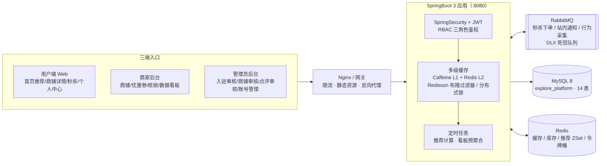

# 本地生活探店平台

> 升级版「黑马点评」—— 集探店点评、优惠券秒杀、个性化推荐、商家数据看板于一体的本地生活服务平台。
> 后端 SpringBoot3 + MySQL8 + Redis + Redisson + RabbitMQ，前端 Vue3 + Element Plus，包含多级缓存、Lua 秒杀、MQ 三场景、User-CF 协同过滤推荐等完整高并发实战方案。

---

## 一、项目简介

本项目是一个三端（用户端 / 商家后台 / 管理员后台）的本地生活探店平台，覆盖「逛店 → 看点评 → 抢券 → 消费核销 → 点评互动」完整业务闭环。

**权限模型**：采用 RBAC 设计，三种角色 `user` / `merchant` / `admin` 共用一张 `tb_user` 账号表，通过 `sys_role` + `sys_user_role` 关联表实现「一人多角色」（例如一个账号可以同时是普通用户和商家）。认证基于 SpringSecurity + JWT，接口层用 `@PreAuthorize` 做角色鉴权，Service 层做数据归属校验，双重防越权。

**与黑马点评的差异化**：

- 商家入驻审核 + 商铺审核 + 点评审核的全套后台审核流；
- RabbitMQ 站内消息通知（点赞 / 审核结果实时触达，带死信队列）；
- 用户行为采集 + User-CF 协同过滤个性化推荐（非简单热度榜）；
- 商家数据看板（定时预聚合 + ECharts 可视化）。

---

## 二、技术栈

| 分类 | 技术选型 |
|------|----------|
| **后端** | SpringBoot 3.3.5、Java 17、MyBatis-Plus、SpringSecurity + JWT、Knife4j（接口文档）、Caffeine（本地缓存） |
| **前端** | Vue 3、Vite、Element Plus、axios（token 拦截 + 角色路由守卫）、ECharts（按需引入） |
| **中间件** | MySQL 8（14 张表）、Redis + Redisson（分布式锁 / 布隆过滤器）、RabbitMQ 4.x（削峰 / 通知 / 行为采集） |
| **测试 / 部署** | JUnit5 + @SpringBootTest、JMeter（500 并发压测）、Maven 3.8.8、Node 22 |

---

## 三、系统架构



---

## 四、核心功能模块

| 模块 | 说明 |
|------|------|
| **用户模块** | 注册 / 登录（JWT）/ 个人信息维护；密码加密存储；三角色统一登录 |
| **商家模块** | 入驻申请 → 管理员审核（通过自动授予 merchant 角色）；商铺 CRUD + 上下架 + 审核；普通券 / 秒杀券发布管理，全部做数据归属校验 |
| **点评模块** | 发布点评（待审核 + 一人一铺一评）、商铺点评分页（公开）、点赞防重（复合主键 + DuplicateKeyException）、取消幂等、管理员审核通过 / 驳回 |
| **收藏模块** | 收藏 / 取消（复合主键幂等）、我的收藏分页（INNER JOIN 商铺摘要，收藏时间倒序） |
| **优惠券秒杀** | Lua 原子扣库存 + 一人一单 + MQ 异步下单 + Redisson DB 兜底 + 唯一键幂等；500 并发实测零超卖 |
| **MQ 站内通知** | 点赞 / 点评审核 / 入驻审核三类事件实时触达；未读数、单条 / 全部已读；死信队列兜底 |
| **行为采集 + 推荐** | 浏览 / 点赞 / 收藏 / 点评四类行为经 MQ 异步落库；User-CF 协同过滤定时计算，首页个性化推荐流 |
| **商家数据看板** | 定时预聚合访问量 / 核销量 / 点评数 / 平均分到统计表，ECharts 双图展示（7~90 天档位），越权访问 403 |

---

## 五、核心难点与解决方案（面试重点）

### 5.1 多级缓存：Caffeine + Redis + 布隆过滤器

针对商铺详情这类「读多写少、热点集中」的场景，设计了四级防护：

1. **L1 Caffeine 本地缓存**：自定义 `Expiry` 实现**随机 TTL**（防缓存雪崩），**空值短 TTL**（防缓存穿透）；实测穿透空值标记 TTL 152s 随机生效。
2. **L2 Redis**：序列化注册 `JavaTimeModule` 解决 `LocalDateTime` 问题。
3. **Redisson 布隆过滤器**：非法商铺 ID 在缓存之前即被拦截，不打 DB。
4. **回源控制**：本地分段锁 / Redisson 分布式锁 + **双重检查**，实测 **20 并发回源仅 1 次 SQL**。

**一致性保障**：更新后通过 Redis **Pub/Sub 广播失效**消息，各节点收到后 evict 本地 L1，保证集群下 L1 不产生脏读；应用**启动预热**热点数据。

### 5.2 优惠券秒杀：Lua + MQ 异步削峰

**核心思路**：接口线程零 DB 写——只做「Lua 原子扣 Redis 库存 → 发 MQ」立即返回，DB 扣减 + 插订单由消费者异步执行，接口吞吐不受 DB 行锁阻塞。

**幂等与防超卖四道防线**：

1. **Lua 脚本**原子完成「一人一单校验 + 库存扣减 + 下单标记」，无并发窗口；
2. **Redisson 分布式锁 DB 兜底**：消费端在锁内执行 `stock > 0` 条件更新，防 Redis 与 DB 数据分歧导致超卖；
3. **`uk_user_voucher(user_id, voucher_id)` 唯一键**：重复消息不会产生重复订单（幂等双保险）；
4. **补偿机制**：MQ 投递失败回滚 Redis 库存 + 移除用户标记；消费端发现重复订单回补 Redis 库存，保证最终一致。

**JMeter 压测（500 并发 / 500 独立 token）**：

| 指标 | 基线（同步 DB 下单） | 优化（Lua + MQ 异步） | 提升 |
|------|------|------|------|
| QPS | 137 | **184** | **+34%** |
| 平均 RT | 2922 ms | 2143 ms | **-27%** |
| 超卖验证 | — | 30 用户 × 3 次抢库存 10：成功恰 10 单，DB / Redis 库存双归零 | **超卖 0** |

### 5.3 RabbitMQ 三大业务场景

| 场景 | 设计要点 |
|------|----------|
| **秒杀下单** | 异步削峰，接口线程不写 DB；投递失败有 Redis 库存补偿 |
| **站内通知** | topic 交换机 + **DLX 死信队列**；**手动 ack + 重试 3 次入 DLQ** + DLQ 消费者兜底；生产者 Confirm / Returns 回调；消息幂等 `(receiver, bizType, bizId)` 先查后插 + 唯一键兜底 |
| **行为采集** | `behavior.exchange`（topic）异步落库，try-catch 包裹**不阻塞主流程**；浏览行为用 Redis `SETNX` 10 分钟窗口去重 |

### 5.4 User-CF 协同过滤推荐

完整实现「行为 → 评分 → 相似度 → 推荐」链路：

1. **行为权重打分**：浏览 w=1 / 点赞 w=4 / 收藏 w=5 / 点评 w=3，构建 30 天窗口用户-商铺评分矩阵；
2. **相似度计算**：倒排点积 + **余弦相似度**，取 TopK=20 近邻用户；
3. **候选打分**：`score = Σ(sim × r)`，取 TopN=10 写入 **Redis ZSet（TTL 2h）**；
4. **定时计算**：整点触发 + 启动 5 分钟后补跑；首页 `GET /api/recommendations` 只读 Redis；
5. **冷启动三级兜底**：个性化推荐 → 热门榜（营业中商铺 Top10）→ 空，新用户也有内容可看。

实测：算法数值经手工核验（推荐分值 = 5/√26 精确命中），浏览去重、TTL、兜底链路全部通过。

### 5.5 商家数据看板：预聚合思想

查询接口**只打统计表、不聚合大表**：

- `DashboardStatTask` 每小时第 5 分钟跑「昨日 0 点 ~ 明日 0 点」窗口 + 启动 10s 补跑；
- 3 条 `INSERT ... ON DUPLICATE KEY UPDATE`（`uk_shop_date` **幂等 upsert**）分别聚合访问量（behavior_type=1）、核销量（订单 status=3 按 use_time）、点评数 + 平均分；**重启重跑行数不翻倍**；
- 为聚合 SQL 补齐 3 个组合索引（见踩坑记录），避免对订单大表全表扫描；
- VO 为 ECharts 定制（日期序列 + 4 数据序列，缺失日期补 0，无点评日期平均分补 null 断点）。

---

## 六、本地部署

### 前置环境

| 依赖 | 版本要求 |
|------|----------|
| JDK | 17 |
| Maven | 3.8.8 |
| Node.js | 22 |
| MySQL | 8（本机 3306） |
| Redis | 5.0+（本机 6379） |
| RabbitMQ | 4.3.x（**需搭配 Erlang/OTP 27~28**，OTP 29 不兼容） |

### 启动步骤

```bash
# 1. 建库建表（可重复执行）
mysql -uroot -p < sql/init.sql        # 创建 explore_platform 库 + 14 张表 + 测试数据

# 2. 启动后端（端口 8080）
cd backend
mvn spring-boot:run
# 中文路径下若 mvn spring-boot:run 报 ClassNotFoundException，改用：
mvn package && java -jar target/explore-platform-*.jar

# 3. 启动前端（端口 5173，/api 已代理到 8080）
cd frontend
npm install
npm run dev
```

- 访问入口：http://localhost:5173
- 接口文档（Knife4j）：http://localhost:8080/doc.html

### 测试账号（密码均为 123456）

| 手机号 | 角色 | 用途 |
|--------|------|------|
| 13900000001 | user + merchant | 体验用户端 + 商家后台（一人多角色） |
| 13920000001 | user | 纯用户视角 |
| 13900000000 | admin | 管理员后台 |

### Docker 一键部署

无需本机安装 JDK / Maven / Node / MySQL / Redis / RabbitMQ，只需 Docker Desktop：

```bash
docker compose up -d --build
```

| 服务 | 镜像/构建 | 端口 | 说明 |
|------|-----------|------|------|
| frontend | 本地构建（Node 构建 + Nginx 托管 dist） | 80 | 访问入口 http://localhost |
| backend | 本地构建（Maven 打包 + JRE 运行） | 8080 | 接口文档 http://localhost:8080/doc.html |
| mysql | mysql:8.0 | 3306 | root/root，首次启动自动执行 sql/init.sql 建库 |
| redis | redis:7 | 6379 | 开启 AOF 持久化 |
| rabbitmq | rabbitmq:3.13-management | 5672 / 15672 | 管理台 http://localhost:15672（guest/guest）；实测 4.3.6 与 Erlang/OTP 29 不兼容，故用 3.13 稳定版 |

**验证方式**：
- 浏览器访问 http://localhost 打开前端，用测试账号（13900000001 / 123456）登录
- 访问 http://localhost:8080/doc.html 查看 Knife4j 接口文档
- `docker compose ps` 确认 mysql / redis / rabbitmq 均为 `healthy`、backend / frontend 为 `running`

**常见问题**：
- **首次启动较慢**：MySQL 容器首次初始化要执行 init.sql（14 张表 + 测试数据），backend 会等 mysql / redis / rabbitmq 三个健康检查全部通过后才启动，属正常现象，可用 `docker compose logs -f backend` 观察进度
- **backend 一直处于 waiting/重启**：多为中间件 healthcheck 未通过，先 `docker compose ps` 查看哪个中间件异常，再 `docker compose logs mysql`（或 redis / rabbitmq）排查
- **MySQL 初始化脚本未执行**：/docker-entrypoint-initdb.d/ 仅在数据卷为空时执行一次，如需重建请 `docker compose down -v` 清空数据卷后重新 `up -d --build`

---

## 七、测试

```bash
cd backend
mvn test
```

核心测试类 `SeckillAndRecommendTest`（@SpringBootTest，5 用例全过，约 24s，对源代码零侵入，测试后自动清理数据）：

| # | 用例 | 验证点 |
|---|------|--------|
| 1 | 秒杀并发无超卖 | 50 线程抢库存 20：成功恰 20 / 失败 30（业务码），MQ 异步落库后订单恰 20 笔且一人一单，DB + Redis 库存双归零 |
| 2 | 重复抢幂等 | 同一用户二次抢抛 503，仅 1 单 |
| 3 | 库存不足 | Redis 库存置 0 后抢抛 501，无订单产生 |
| 4 | User-CF 数值正确性 | 已知权重造数，推荐结果恰为预期商铺且分值 = 5/√26（手工核算），ZSet 带 2h TTL |
| 5 | 冷启动兜底 | 无行为用户的推荐结果 == 热门榜 Top10 营业中商铺 |

---

## 八、踩坑记录（现象 → 根因 → 解法）

1. **MyBatis-Plus 3.5.9 分页插件失效**
   现象：升级后分页报错 / 不生效。根因：3.5.9 起 `jsqlparser` 被拆分为独立依赖。解法：显式引入 `mybatis-plus-jsqlparser` 依赖。

2. **GenericJackson2JsonRedisSerializer 不支持 LocalDateTime**
   现象：实体含 `LocalDateTime` 字段缓存时序列化报错。根因：默认 Jackson 未注册 JSR-310 模块。解法：RedisConfig 中注册 `JavaTimeModule` 自定义 ObjectMapper。

3. **RabbitMQ 4.3.6 与 Erlang/OTP 29 不兼容**
   现象：RabbitMQ 启动即崩溃（产生 erl_crash.dump）。根因：版本兼容矩阵限制。解法：降级 Erlang/OTP 到 27~28。

4. **雪花 ID 返回前端精度丢失**
   现象：秒杀下单返回的订单 ID 到前端后末位失真，支付 404。根因：雪花 ID（Long）超 JS 安全整数 2^53。解法：接口返回 `String.valueOf(id)`，VO 中 ID 字段统一 String 类型。

5. **mvn spring-boot:run 在中文路径下启动失败**
   现象：fork JVM 报 `ClassNotFoundException`。根因：中文路径经 fork 传参时编码丢失。解法：`mvn package` 后 `java -jar` 启动。

6. **秒杀测试 del 库存 key 后测试失真**
   现象：单测中 `del` Redis 库存 key 模拟售罄，结果请求仍成功。根因：`ensureStockPrewarm` 发现 key 不存在会按 DB 库存回填。解法：测试须将库存 **置 "0"** 而非删除 key。

7. **403 与 401 语义混淆**
   现象：未登录访问返回 403（应 401），登录但越权与未登录无法区分。根因：SpringSecurity 默认异常处理未区分认证 / 授权失败，且白名单配置有遗漏。解法：SecurityConfig 精确配置白名单（如仅放行 `GET /api/shops/**`），新增 `RestAuthenticationEntryPoint`（401）与 `RestAccessDeniedHandler`（403）分别处理。

8. **看板聚合 SQL 全表扫描（阶段 6-2 优化）**
   现象：SQL 审查发现 `DashboardStatTask` 三条聚合语句无可用索引。根因：`tb_user_behavior` 缺 `(behavior_type, create_time)`、`tb_voucher_order` 缺 `(status, use_time)`、`tb_review` 缺 `(create_time)`。解法：补 3 个组合索引（已同步进 `sql/init.sql`）；同时给 13 个分页接口统一 `pageSize ≤ 100` 封顶防刷。

---

## 九、目录结构

```
本地生活探店平台/
├── backend/                        # 后端工程（SpringBoot 3.3.5，端口 8080）
│   └── src/main/java/com/explore/platform/
│       ├── controller/             # 接口层（用户/商家/管理员三套）
│       ├── service/                # 业务层（多级缓存、秒杀、推荐、看板）
│       ├── mapper/  entity/  dto/  vo/
│       ├── cache/                  # Caffeine L1 + Redis L2 + 布隆过滤器 + Pub/Sub 失效
│       ├── mq/                     # RabbitMQ 生产者/消费者/DLX（秒杀/通知/行为采集）
│       ├── security/               # SpringSecurity + JWT + RBAC
│       ├── task/                   # 定时任务（推荐计算 / 看板预聚合）
│       ├── ratelimit/              # Redis 令牌桶限流
│       ├── config/  common/        # 配置、统一返回体、全局异常
│       └── src/test/               # SeckillAndRecommendTest（5 核心用例）
├── frontend/                       # 前端工程（Vue3 + Vite，端口 5173）
│   └── src/
│       ├── views/                  # 用户端 / 商家后台 / 管理员后台页面
│       ├── layouts/  router/       # 三端布局 + 角色路由守卫
│       └── utils/                  # axios 封装（token 拦截）、格式化工具
├── sql/init.sql                    # 建库脚本（14 张表 + 测试数据，可重复执行）
├── jmeter/                         # 秒杀压测脚本与 token 数据
├── 阶段0-需求设计文档.md            # 需求 / ER 图 / 接口清单
├── 阶段0-2-业务流程图与架构图.md     # 秒杀 / 消息 / 推荐 / 架构 Mermaid 图
├── 阶段3-2-秒杀压测报告.md          # 500 并发压测数据
├── 阶段6-2-代码与SQL优化检查报告.md  # 安全与性能审查（10 项）
└── 开发步骤AI Agent提示词.md        # 全流程开发记录与进度看板
```

### 数据库 14 张表一览

`tb_user`、`sys_role`、`sys_user_role`（RBAC）、`tb_merchant`（商家入驻）、`tb_shop`（商铺）、`tb_voucher`、`tb_seckill_voucher`（秒杀券）、`tb_voucher_order`（券订单，雪花 ID + 唯一键幂等）、`tb_review`（点评）、`tb_review_like`（点赞，复合主键）、`tb_favorite`（收藏，复合主键）、`tb_message`（站内消息，幂等三元组）、`tb_user_behavior`（行为日志）、`tb_shop_daily_stat`（看板预聚合统计表）。
