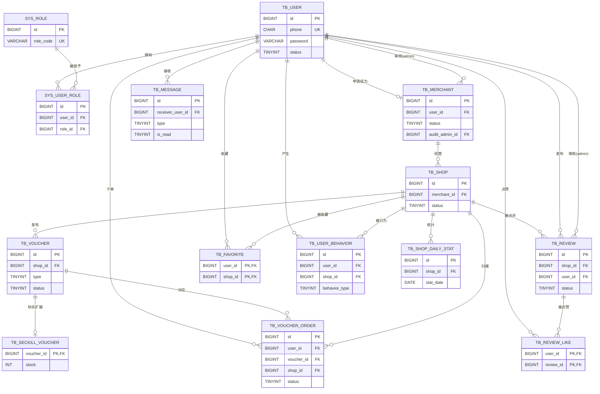

# 本地生活探店平台 · MySQL 表结构与 ER 图设计

> 本文件为【全局角色设定】+【提示词 0-1】的执行交付物，严格按提示词 5 条要求输出。
> 表结构与《阶段0-需求设计文档.md》为同一版本，本文档只聚焦数据库设计本身。

**提示词要求回顾**：

1. 区分普通用户、商家、管理员三种角色；
2. 支持优惠券秒杀、商铺点评、消息推送、用户浏览行为记录；
3. 输出完整建表 SQL，每字段注释，标注主键、索引、外键关系；
4. 输出 ER 图 Markdown（Mermaid）文本；
5. 不照搬黑马点评，商家表、消息表、行为日志表体现差异。

---

## 一、设计约定

| 项 | 约定 |
|----|------|
| 数据库 | MySQL 8.x，引擎 InnoDB，字符集 utf8mb4 |
| 主键 | `BIGINT UNSIGNED AUTO_INCREMENT`（订单表用雪花 ID，全局唯一） |
| 金额 | `DECIMAL`，禁止用浮点 |
| 时间 | 统一 `create_time` / `update_time`，后者 `ON UPDATE CURRENT_TIMESTAMP` |
| 外键 | **不建物理外键约束**（高并发写入场景便于分库分表与性能控制），表间关系通过索引 + 应用层保证，关系在[第四节](#四逻辑外键关系清单)统一标注 |
| 状态字段 | 一律 `TINYINT` + 注释列出取值含义 |

---

## 二、表清单总览

| # | 表名 | 类别 | 说明 |
|---|------|------|------|
| 1 | tb_user | 用户 | 统一账号表，三种角色共用 |
| 2 | sys_role | 角色（RBAC） | user / merchant / admin |
| 3 | sys_user_role | 角色（RBAC） | 用户-角色多对多 |
| 4 | tb_merchant | 商家信息 | **差异化**：入驻申请/审核资料 |
| 5 | tb_shop | 商铺 | 商家名下商铺 |
| 6 | tb_voucher | 优惠券 | 普通券 + 秒杀券 |
| 7 | tb_seckill_voucher | 优惠券 | **差异化**：秒杀库存独立热点表 |
| 8 | tb_voucher_order | 订单 | 秒杀/普通券订单，含核销 |
| 9 | tb_review | 点评 | 含审核状态 |
| 10 | tb_review_like | 点赞收藏 | 点赞（复合主键防重） |
| 11 | tb_favorite | 点赞收藏 | 收藏（复合主键防重） |
| 12 | tb_message | 站内消息 | **差异化**：通知持久化/已读未读 |
| 13 | tb_user_behavior | 行为日志 | **差异化**：只追加，供推荐计算 |
| 14 | tb_shop_daily_stat | 统计 | 看板预聚合 |

---

## 三、完整建表 SQL

```sql
-- ============================================================
-- 1. 用户表（三种角色共用同一账号体系，角色由 RBAC 关联表区分）
-- ============================================================
CREATE TABLE tb_user (
    id          BIGINT UNSIGNED NOT NULL AUTO_INCREMENT COMMENT '用户ID',
    phone       CHAR(11)        NOT NULL COMMENT '手机号（登录账号）',
    password    VARCHAR(100)    NOT NULL COMMENT 'BCrypt 加密密码',
    nickname    VARCHAR(64)     NOT NULL DEFAULT '' COMMENT '昵称',
    avatar      VARCHAR(255)             DEFAULT '' COMMENT '头像URL',
    gender      TINYINT         NOT NULL DEFAULT 2 COMMENT '性别 0男 1女 2未知',
    status      TINYINT         NOT NULL DEFAULT 1 COMMENT '状态 1正常 0冻结',
    create_time DATETIME        NOT NULL DEFAULT CURRENT_TIMESTAMP COMMENT '创建时间',
    update_time DATETIME        NOT NULL DEFAULT CURRENT_TIMESTAMP ON UPDATE CURRENT_TIMESTAMP COMMENT '更新时间',
    PRIMARY KEY (id),
    UNIQUE KEY uk_phone (phone)
) ENGINE = InnoDB DEFAULT CHARSET = utf8mb4 COMMENT ='用户表';

-- ============================================================
-- 2. 角色表
-- ============================================================
CREATE TABLE sys_role (
    id          BIGINT UNSIGNED NOT NULL AUTO_INCREMENT COMMENT '角色ID',
    role_code   VARCHAR(32)     NOT NULL COMMENT '角色编码 user/merchant/admin',
    role_name   VARCHAR(32)     NOT NULL COMMENT '角色名称',
    description VARCHAR(128)             DEFAULT '' COMMENT '描述',
    status      TINYINT         NOT NULL DEFAULT 1 COMMENT '1启用 0停用',
    create_time DATETIME        NOT NULL DEFAULT CURRENT_TIMESTAMP COMMENT '创建时间',
    update_time DATETIME        NOT NULL DEFAULT CURRENT_TIMESTAMP ON UPDATE CURRENT_TIMESTAMP COMMENT '更新时间',
    PRIMARY KEY (id),
    UNIQUE KEY uk_role_code (role_code)
) ENGINE = InnoDB DEFAULT CHARSET = utf8mb4 COMMENT ='角色表';

-- ============================================================
-- 3. 用户角色关联表（多对多）
-- ============================================================
CREATE TABLE sys_user_role (
    id      BIGINT UNSIGNED NOT NULL AUTO_INCREMENT COMMENT '主键',
    user_id BIGINT UNSIGNED NOT NULL COMMENT '用户ID（逻辑外键 → tb_user.id）',
    role_id BIGINT UNSIGNED NOT NULL COMMENT '角色ID（逻辑外键 → sys_role.id）',
    PRIMARY KEY (id),
    UNIQUE KEY uk_user_role (user_id, role_id),
    KEY idx_role_id (role_id)
) ENGINE = InnoDB DEFAULT CHARSET = utf8mb4 COMMENT ='用户角色关联表';

-- ============================================================
-- 4. 商家信息表【差异化：入驻申请 + 审核流转】
-- ============================================================
CREATE TABLE tb_merchant (
    id             BIGINT UNSIGNED NOT NULL AUTO_INCREMENT COMMENT '商家ID',
    user_id        BIGINT UNSIGNED NOT NULL COMMENT '关联用户ID（逻辑外键 → tb_user.id）',
    merchant_name  VARCHAR(128)    NOT NULL COMMENT '商家/公司名称',
    license_no     VARCHAR(64)     NOT NULL COMMENT '营业执照编号',
    license_img    VARCHAR(255)             DEFAULT '' COMMENT '营业执照照片',
    contact_name   VARCHAR(32)     NOT NULL COMMENT '联系人',
    contact_phone  CHAR(11)        NOT NULL COMMENT '联系电话',
    status         TINYINT         NOT NULL DEFAULT 0 COMMENT '状态 0待审核 1已通过 2已驳回',
    audit_admin_id BIGINT UNSIGNED          DEFAULT NULL COMMENT '审核管理员ID（逻辑外键 → tb_user.id）',
    audit_time     DATETIME                 DEFAULT NULL COMMENT '审核时间',
    audit_remark   VARCHAR(255)             DEFAULT '' COMMENT '审核备注/驳回原因',
    create_time    DATETIME        NOT NULL DEFAULT CURRENT_TIMESTAMP COMMENT '创建时间',
    update_time    DATETIME        NOT NULL DEFAULT CURRENT_TIMESTAMP ON UPDATE CURRENT_TIMESTAMP COMMENT '更新时间',
    PRIMARY KEY (id),
    UNIQUE KEY uk_user_id (user_id),
    KEY idx_status (status)
) ENGINE = InnoDB DEFAULT CHARSET = utf8mb4 COMMENT ='商家信息表';

-- ============================================================
-- 5. 商铺表
-- ============================================================
CREATE TABLE tb_shop (
    id          BIGINT UNSIGNED NOT NULL AUTO_INCREMENT COMMENT '商铺ID',
    merchant_id BIGINT UNSIGNED NOT NULL COMMENT '所属商家ID（逻辑外键 → tb_merchant.id）',
    name        VARCHAR(128)    NOT NULL COMMENT '商铺名称',
    type_id     INT             NOT NULL COMMENT '商铺类型ID',
    type_name   VARCHAR(32)     NOT NULL DEFAULT '' COMMENT '类型名称（冗余）',
    province    VARCHAR(32)              DEFAULT '' COMMENT '省',
    city        VARCHAR(32)              DEFAULT '' COMMENT '市',
    address     VARCHAR(255)    NOT NULL COMMENT '详细地址',
    longitude   DECIMAL(10, 7)           DEFAULT NULL COMMENT '经度',
    latitude    DECIMAL(10, 7)           DEFAULT NULL COMMENT '纬度',
    cover_img   VARCHAR(255)             DEFAULT '' COMMENT '封面图',
    images      VARCHAR(1000)            DEFAULT '' COMMENT '门店图片，逗号分隔',
    description TEXT                     DEFAULT NULL COMMENT '简介',
    avg_price   DECIMAL(10, 2)           DEFAULT 0 COMMENT '人均消费',
    status      TINYINT         NOT NULL DEFAULT 0 COMMENT '0待审核 1营业 2已下架',
    create_time DATETIME        NOT NULL DEFAULT CURRENT_TIMESTAMP COMMENT '创建时间',
    update_time DATETIME        NOT NULL DEFAULT CURRENT_TIMESTAMP ON UPDATE CURRENT_TIMESTAMP COMMENT '更新时间',
    PRIMARY KEY (id),
    KEY idx_merchant (merchant_id),
    KEY idx_status (status)
) ENGINE = InnoDB DEFAULT CHARSET = utf8mb4 COMMENT ='商铺表';

-- ============================================================
-- 6. 优惠券表
-- ============================================================
CREATE TABLE tb_voucher (
    id           BIGINT UNSIGNED NOT NULL AUTO_INCREMENT COMMENT '优惠券ID',
    shop_id      BIGINT UNSIGNED NOT NULL COMMENT '所属商铺ID（逻辑外键 → tb_shop.id）',
    title        VARCHAR(128)    NOT NULL COMMENT '券标题',
    sub_title    VARCHAR(255)             DEFAULT '' COMMENT '副标题',
    rules        VARCHAR(512)             DEFAULT '' COMMENT '使用规则',
    pay_value    DECIMAL(10, 2)  NOT NULL COMMENT '支付金额',
    actual_value DECIMAL(10, 2)  NOT NULL COMMENT '抵扣金额',
    type         TINYINT         NOT NULL DEFAULT 0 COMMENT '类型 0普通券 1秒杀券',
    status       TINYINT         NOT NULL DEFAULT 1 COMMENT '1上架 0下架',
    begin_time   DATETIME                 DEFAULT NULL COMMENT '生效时间',
    end_time     DATETIME                 DEFAULT NULL COMMENT '失效时间',
    create_time  DATETIME        NOT NULL DEFAULT CURRENT_TIMESTAMP COMMENT '创建时间',
    update_time  DATETIME        NOT NULL DEFAULT CURRENT_TIMESTAMP ON UPDATE CURRENT_TIMESTAMP COMMENT '更新时间',
    PRIMARY KEY (id),
    KEY idx_shop (shop_id),
    KEY idx_end_time (end_time)
) ENGINE = InnoDB DEFAULT CHARSET = utf8mb4 COMMENT ='优惠券表';

-- ============================================================
-- 7. 秒杀券表【差异化：库存独立成热点表】
-- ============================================================
CREATE TABLE tb_seckill_voucher (
    voucher_id    BIGINT UNSIGNED NOT NULL COMMENT '关联优惠券ID（逻辑外键 → tb_voucher.id）',
    initial_stock INT             NOT NULL COMMENT '初始库存',
    stock         INT             NOT NULL COMMENT '剩余库存（DB 兜底值，主库存由 Redis 承载）',
    begin_time    DATETIME        NOT NULL COMMENT '秒杀开始时间',
    end_time      DATETIME        NOT NULL COMMENT '秒杀结束时间',
    create_time   DATETIME        NOT NULL DEFAULT CURRENT_TIMESTAMP COMMENT '创建时间',
    update_time   DATETIME        NOT NULL DEFAULT CURRENT_TIMESTAMP ON UPDATE CURRENT_TIMESTAMP COMMENT '更新时间',
    PRIMARY KEY (voucher_id),
    KEY idx_time (begin_time, end_time)
) ENGINE = InnoDB DEFAULT CHARSET = utf8mb4 COMMENT ='秒杀券表';

-- ============================================================
-- 8. 优惠券订单表
-- ============================================================
CREATE TABLE tb_voucher_order (
    id           BIGINT UNSIGNED NOT NULL COMMENT '订单ID（雪花算法）',
    user_id      BIGINT UNSIGNED NOT NULL COMMENT '下单用户ID（逻辑外键 → tb_user.id）',
    voucher_id   BIGINT UNSIGNED NOT NULL COMMENT '优惠券ID（逻辑外键 → tb_voucher.id）',
    shop_id      BIGINT UNSIGNED NOT NULL COMMENT '商铺ID（逻辑外键 → tb_shop.id，冗余便于归属校验）',
    order_type   TINYINT         NOT NULL DEFAULT 1 COMMENT '订单类型 0普通 1秒杀',
    status       TINYINT         NOT NULL DEFAULT 1 COMMENT '1未支付 2已支付待核销 3已核销 4已退款 5已关闭',
    pay_type     TINYINT                  DEFAULT NULL COMMENT '支付方式',
    create_time  DATETIME        NOT NULL DEFAULT CURRENT_TIMESTAMP COMMENT '下单时间',
    pay_time     DATETIME                 DEFAULT NULL COMMENT '支付时间',
    use_time     DATETIME                 DEFAULT NULL COMMENT '核销时间',
    refund_time  DATETIME                 DEFAULT NULL COMMENT '退款时间',
    close_time   DATETIME                 DEFAULT NULL COMMENT '关闭时间',
    PRIMARY KEY (id),
    UNIQUE KEY uk_user_voucher (user_id, voucher_id) COMMENT '每人每券限购1份 + 订单幂等兜底',
    KEY idx_user (user_id),
    KEY idx_voucher (voucher_id),
    KEY idx_shop_status (shop_id, status),
    KEY idx_create_time (create_time)
) ENGINE = InnoDB DEFAULT CHARSET = utf8mb4 COMMENT ='优惠券订单表';

-- ============================================================
-- 9. 点评表
-- ============================================================
CREATE TABLE tb_review (
    id             BIGINT UNSIGNED NOT NULL AUTO_INCREMENT COMMENT '点评ID',
    shop_id        BIGINT UNSIGNED NOT NULL COMMENT '商铺ID（逻辑外键 → tb_shop.id）',
    user_id        BIGINT UNSIGNED NOT NULL COMMENT '发布用户ID（逻辑外键 → tb_user.id）',
    title          VARCHAR(128)    NOT NULL COMMENT '标题',
    content        TEXT            NOT NULL COMMENT '正文',
    images         VARCHAR(1000)            DEFAULT '' COMMENT '图片，逗号分隔',
    score          TINYINT         NOT NULL DEFAULT 5 COMMENT '评分 1~5',
    status         TINYINT         NOT NULL DEFAULT 0 COMMENT '0待审核 1已通过 2已驳回',
    audit_admin_id BIGINT UNSIGNED           DEFAULT NULL COMMENT '审核管理员ID（逻辑外键 → tb_user.id）',
    audit_time     DATETIME                 DEFAULT NULL COMMENT '审核时间',
    audit_remark   VARCHAR(255)             DEFAULT '' COMMENT '审核备注',
    create_time    DATETIME        NOT NULL DEFAULT CURRENT_TIMESTAMP COMMENT '创建时间',
    update_time    DATETIME        NOT NULL DEFAULT CURRENT_TIMESTAMP ON UPDATE CURRENT_TIMESTAMP COMMENT '更新时间',
    PRIMARY KEY (id),
    KEY idx_shop_time (shop_id, create_time),
    KEY idx_user (user_id),
    KEY idx_status (status)
) ENGINE = InnoDB DEFAULT CHARSET = utf8mb4 COMMENT ='点评表';

-- ============================================================
-- 10. 点评点赞表（复合主键天然防重）
-- ============================================================
CREATE TABLE tb_review_like (
    user_id     BIGINT UNSIGNED NOT NULL COMMENT '用户ID（逻辑外键 → tb_user.id）',
    review_id   BIGINT UNSIGNED NOT NULL COMMENT '点评ID（逻辑外键 → tb_review.id）',
    create_time DATETIME        NOT NULL DEFAULT CURRENT_TIMESTAMP COMMENT '点赞时间',
    PRIMARY KEY (user_id, review_id),
    KEY idx_review (review_id)
) ENGINE = InnoDB DEFAULT CHARSET = utf8mb4 COMMENT ='点评点赞表';

-- ============================================================
-- 11. 商铺收藏表（复合主键天然防重）
-- ============================================================
CREATE TABLE tb_favorite (
    user_id     BIGINT UNSIGNED NOT NULL COMMENT '用户ID（逻辑外键 → tb_user.id）',
    shop_id     BIGINT UNSIGNED NOT NULL COMMENT '商铺ID（逻辑外键 → tb_shop.id）',
    create_time DATETIME        NOT NULL DEFAULT CURRENT_TIMESTAMP COMMENT '收藏时间',
    PRIMARY KEY (user_id, shop_id),
    KEY idx_user_time (user_id, create_time)
) ENGINE = InnoDB DEFAULT CHARSET = utf8mb4 COMMENT ='商铺收藏表';

-- ============================================================
-- 12. 站内消息表【差异化：通知持久化】
-- ============================================================
CREATE TABLE tb_message (
    id               BIGINT UNSIGNED NOT NULL AUTO_INCREMENT COMMENT '消息ID',
    receiver_user_id BIGINT UNSIGNED NOT NULL COMMENT '接收人用户ID（逻辑外键 → tb_user.id）',
    type             TINYINT         NOT NULL COMMENT '类型 1点赞提醒 2优惠券到期 3入驻审核结果 4点评审核结果',
    title            VARCHAR(128)    NOT NULL COMMENT '标题',
    content          VARCHAR(512)    NOT NULL COMMENT '内容',
    biz_type         VARCHAR(32)              DEFAULT '' COMMENT '业务类型（幂等去重维度之一）',
    biz_id           BIGINT UNSIGNED           DEFAULT NULL COMMENT '关联业务ID（幂等去重维度之一）',
    is_read          TINYINT         NOT NULL DEFAULT 0 COMMENT '0未读 1已读',
    create_time      DATETIME        NOT NULL DEFAULT CURRENT_TIMESTAMP COMMENT '创建时间',
    read_time        DATETIME                 DEFAULT NULL COMMENT '阅读时间',
    PRIMARY KEY (id),
    KEY idx_receiver_read (receiver_user_id, is_read, create_time)
) ENGINE = InnoDB DEFAULT CHARSET = utf8mb4 COMMENT ='站内消息表';

-- ============================================================
-- 13. 用户行为日志表【差异化：只追加，推荐数据源】
-- ============================================================
CREATE TABLE tb_user_behavior (
    id            BIGINT UNSIGNED NOT NULL AUTO_INCREMENT COMMENT '日志ID',
    user_id       BIGINT UNSIGNED NOT NULL COMMENT '用户ID（逻辑外键 → tb_user.id）',
    shop_id       BIGINT UNSIGNED NOT NULL COMMENT '商铺ID（逻辑外键 → tb_shop.id）',
    behavior_type TINYINT         NOT NULL COMMENT '1浏览 2点赞 3收藏 4点评',
    weight        INT             NOT NULL DEFAULT 1 COMMENT '行为权重 浏览1/点评3/点赞4/收藏5',
    create_time   DATETIME        NOT NULL DEFAULT CURRENT_TIMESTAMP COMMENT '行为时间',
    PRIMARY KEY (id),
    KEY idx_user_time (user_id, create_time),
    KEY idx_shop (shop_id),
    KEY idx_time (create_time)
) ENGINE = InnoDB DEFAULT CHARSET = utf8mb4 COMMENT ='用户行为日志表';

-- ============================================================
-- 14. 商铺日统计表（看板预聚合，非0-1硬性要求，配套看板模块）
-- ============================================================
CREATE TABLE tb_shop_daily_stat (
    id             BIGINT UNSIGNED NOT NULL AUTO_INCREMENT COMMENT '主键',
    shop_id        BIGINT UNSIGNED NOT NULL COMMENT '商铺ID（逻辑外键 → tb_shop.id）',
    stat_date      DATE            NOT NULL COMMENT '统计日期',
    visit_count    INT             NOT NULL DEFAULT 0 COMMENT '当日访问量',
    writeoff_count INT             NOT NULL DEFAULT 0 COMMENT '当日核销数量',
    review_count   INT             NOT NULL DEFAULT 0 COMMENT '当日点评数',
    avg_score      DECIMAL(3, 2)            DEFAULT NULL COMMENT '当日平均评分',
    create_time    DATETIME        NOT NULL DEFAULT CURRENT_TIMESTAMP COMMENT '创建时间',
    update_time    DATETIME        NOT NULL DEFAULT CURRENT_TIMESTAMP ON UPDATE CURRENT_TIMESTAMP COMMENT '更新时间',
    PRIMARY KEY (id),
    UNIQUE KEY uk_shop_date (shop_id, stat_date)
) ENGINE = InnoDB DEFAULT CHARSET = utf8mb4 COMMENT ='商铺日统计表';

-- ============================================================
-- 初始化角色数据
-- ============================================================
INSERT INTO sys_role (role_code, role_name, description)
VALUES ('user', '普通用户', '浏览/点评/收藏/秒杀/推荐'),
       ('merchant', '商家', '商铺管理/优惠券管理/核销/数据看板'),
       ('admin', '平台管理员', '审核/账号/角色管理');
```

---

## 四、逻辑外键关系清单

> 不建物理外键，但以下关系由应用层保证完整性，并均已在从表建立索引。

| # | 子表.字段 | → | 父表.字段 | 关系 | 说明 |
|---|-----------|---|-----------|------|------|
| 1 | sys_user_role.user_id | → | tb_user.id | 多对一 | 用户被授予角色 |
| 2 | sys_user_role.role_id | → | sys_role.id | 多对一 | 角色被用户持有 |
| 3 | tb_merchant.user_id | → | tb_user.id | 一对一 | 账号的商家资料 |
| 4 | tb_merchant.audit_admin_id | → | tb_user.id | 多对一 | 审核人（admin） |
| 5 | tb_shop.merchant_id | → | tb_merchant.id | 多对一 | 商家拥有商铺 |
| 6 | tb_voucher.shop_id | → | tb_shop.id | 多对一 | 商铺发布优惠券 |
| 7 | tb_seckill_voucher.voucher_id | → | tb_voucher.id | 一对一 | 秒杀券扩展信息 |
| 8 | tb_voucher_order.user_id | → | tb_user.id | 多对一 | 用户订单 |
| 9 | tb_voucher_order.voucher_id | → | tb_voucher.id | 多对一 | 券对应订单 |
| 10 | tb_voucher_order.shop_id | → | tb_shop.id | 多对一 | 订单归属商铺 |
| 11 | tb_review.shop_id | → | tb_shop.id | 多对一 | 商铺的点评 |
| 12 | tb_review.user_id | → | tb_user.id | 多对一 | 用户的点评 |
| 13 | tb_review.audit_admin_id | → | tb_user.id | 多对一 | 点评审核人 |
| 14 | tb_review_like.review_id | → | tb_review.id | 多对一 | 点评被点赞 |
| 15 | tb_favorite.shop_id | → | tb_shop.id | 多对一 | 商铺被收藏 |
| 16 | tb_message.receiver_user_id | → | tb_user.id | 多对一 | 消息接收人 |
| 17 | tb_user_behavior.user_id | → | tb_user.id | 多对一 | 行为发起人 |
| 18 | tb_user_behavior.shop_id | → | tb_shop.id | 多对一 | 被行为商铺 |
| 19 | tb_shop_daily_stat.shop_id | → | tb_shop.id | 多对一 | 商铺统计 |

---

## 五、索引设计说明（高频查询场景对照）

| 表 | 索引 | 支撑的查询场景 |
|----|------|---------------|
| tb_user | uk_phone | 手机号登录 |
| sys_user_role | uk_user_role | 查用户角色 + 防重复授权 |
| tb_merchant | uk_user_id / idx_status | 查入驻资料 / 待审核列表 |
| tb_shop | idx_merchant / idx_status | 商家查名下商铺 / 审核列表 |
| tb_voucher | idx_shop / idx_end_time | 店铺券列表 / 到期扫描任务 |
| tb_seckill_voucher | idx_time | 活动是否在有效期 |
| tb_voucher_order | uk_user_voucher | 一人一单 + **订单幂等兜底** |
| tb_voucher_order | idx_shop_status | 商家查本店待核销订单 |
| tb_review | idx_shop_time | 商铺点评分页（时间倒序） |
| tb_review | idx_status | 待审核点评列表 |
| tb_message | idx_receiver_read | 未读消息列表 / 未读数 |
| tb_user_behavior | idx_user_time / idx_time | 推荐计算取数 / 按时间增量计算 |
| tb_shop_daily_stat | uk_shop_date | 看板按日期范围查询、防重复聚合 |

---

## 六、ER 图（Mermaid）



---

## 七、与黑马点评的差异化对照（面试口径）

| 设计点 | 黑马点评 | 本项目 | 差异化价值 |
|--------|----------|--------|-----------|
| 角色区分 | 用户单一角色，达人探店字段 | **统一账号 + RBAC 关联表**，user/merchant/admin | 支持商家入驻与后台管理，权限可扩展 |
| 商家资料 | 无独立商家体系 | **tb_merchant 独立表**，含入驻申请、审核流转 | 业务闭环，面试可讲状态机 |
| 秒杀库存 | voucher 表带库存字段 | **tb_seckill_voucher 独立热点表**，Redis 为主库存、DB 兜底 | 热点隔离，普通券与秒杀券解耦 |
| 订单幂等 | Redis 一人一单 + 分布式锁 | Redis Lua 原子扣减 + **订单表 (user_id,voucher_id) 唯一键双保险** | MQ 重复投递也不会产生重复订单 |
| 消息通知 | 无 | **tb_message 持久化**，已读未读，biz_type+biz_id 幂等 | 支撑点赞/到期/审核三类通知 |
| 行为数据 | 无 | **tb_user_behavior 只追加日志**，带行为权重 | 协同过滤推荐的数据底座 |
| 统计查询 | 无 | **tb_shop_daily_stat 预聚合** | 看板不做大表实时聚合 |

---

## 八、执行与验证步骤

1. MySQL8 中创建数据库：

```sql
CREATE DATABASE explore_platform DEFAULT CHARACTER SET utf8mb4 COLLATE utf8mb4_general_ci;
USE explore_platform;
```

2. 按第三节顺序执行全部建表 SQL（表之间无物理外键，顺序不强制）。
3. 验证：

```sql
SHOW TABLES;                       -- 应为 14 张表
SELECT * FROM sys_role;            -- 应有 3 条角色数据
SHOW INDEX FROM tb_voucher_order;  -- 确认 uk_user_voucher 唯一索引存在
```

4. 建议补造测试数据后再进入阶段 1（脚手架），避免后续联调空表。
