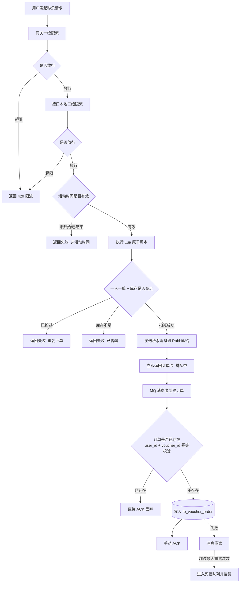
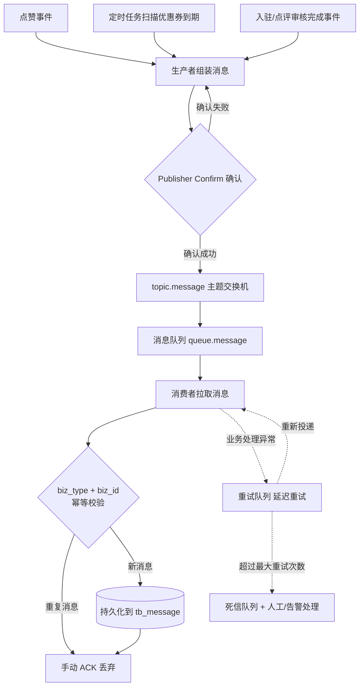
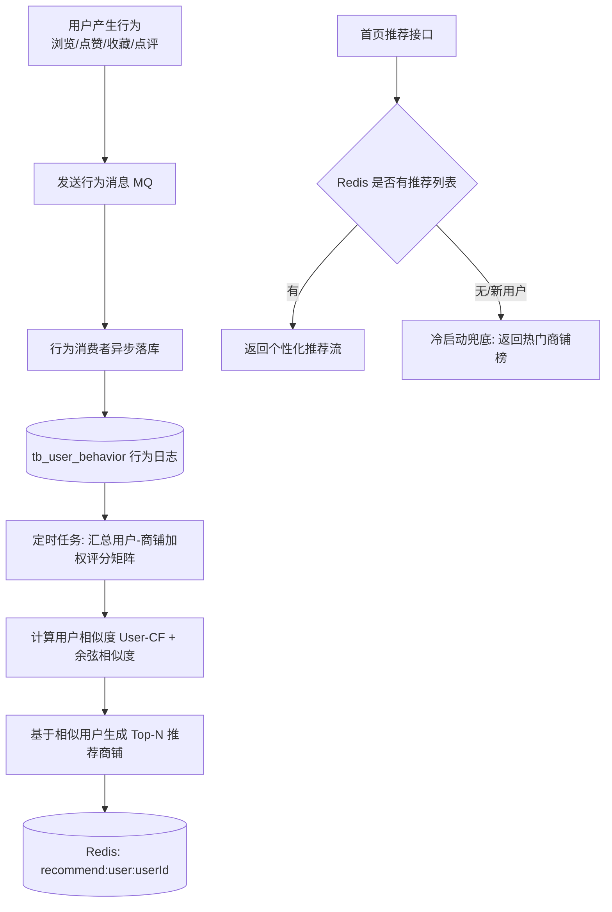
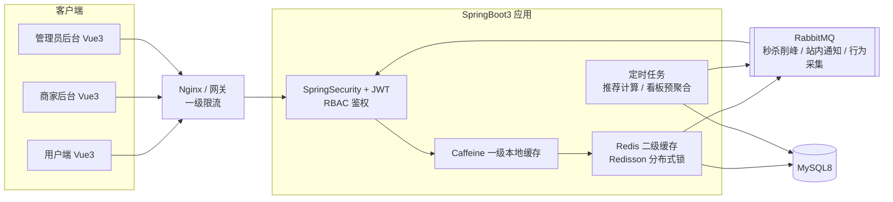

# 本地生活探店平台 · 业务流程图与架构图

> 本文件为【全局角色设定】+【提示词 0-2】的执行交付物。
> 按提示词要求：只包含 4 张图的 Mermaid 代码与必要图注，不含其他代码。
> 图中组件与《阶段0-需求设计文档.md》《阶段0-1-MySQL表结构与ER图.md》的表结构、接口清单完全一致。

---

## 图1：优惠券秒杀流程图

> 图注：请求依次经过网关一级限流、接口本地二级限流；活动时间校验后，用 Lua 脚本在 Redis 中原子完成"一人一单校验 + 库存扣减 + 用户标记"，成功则发 MQ 立即返回，消费者异步落单；订单表唯一键保证幂等，消费失败重试后进死信队列。

---

## 图2：消息推送流程图

> 图注：三类业务事件（点赞、优惠券到期定时扫描、入驻/点评审核完成）统一经生产者以 confirm 确认方式投递到 topic 交换机；消费者先按 biz_type + biz_id 做幂等校验，再持久化到 tb_message 并手动 ACK；处理失败走重试队列，超限进入死信队列。

---

## 图3：推荐流计算流程图

> 图注：用户浏览/点赞/收藏/点评四类行为先经 MQ 异步写入 tb_user_behavior，不阻塞主流程；定时任务按行为权重汇总用户-商铺评分矩阵，用 User-CF 余弦相似度计算相似用户并生成 Top-N 推荐列表写入 Redis；首页推荐接口直接读 Redis，无数据或新用户时以热门商铺榜冷启动兜底。

---

## 图4：系统架构图

> 图注：三类前端（用户端、商家后台、管理员后台）经 Nginx/网关统一入口（一级限流）进入 SpringBoot3 应用；应用内由 Security+JWT 完成 RBAC 鉴权，商铺热点数据走 Caffeine 一级缓存 + Redis 二级缓存，Redisson 提供分布式锁；RabbitMQ 承担秒杀下单削峰、站内通知、行为采集三类异步链路；定时任务负责推荐计算与看板预聚合；最终数据落 MySQL8。

