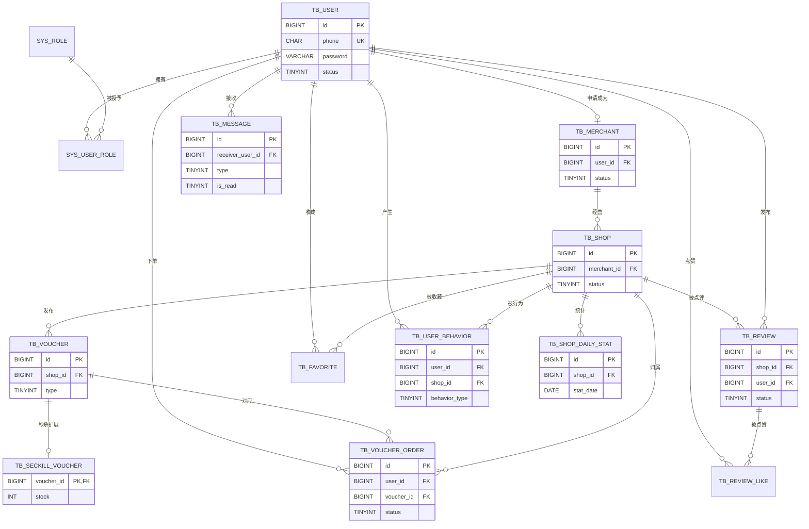
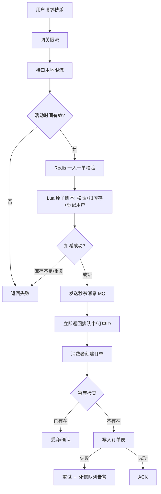
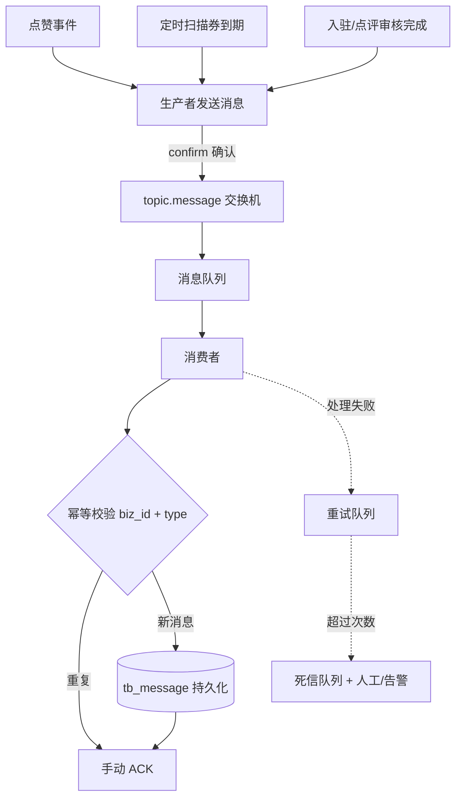
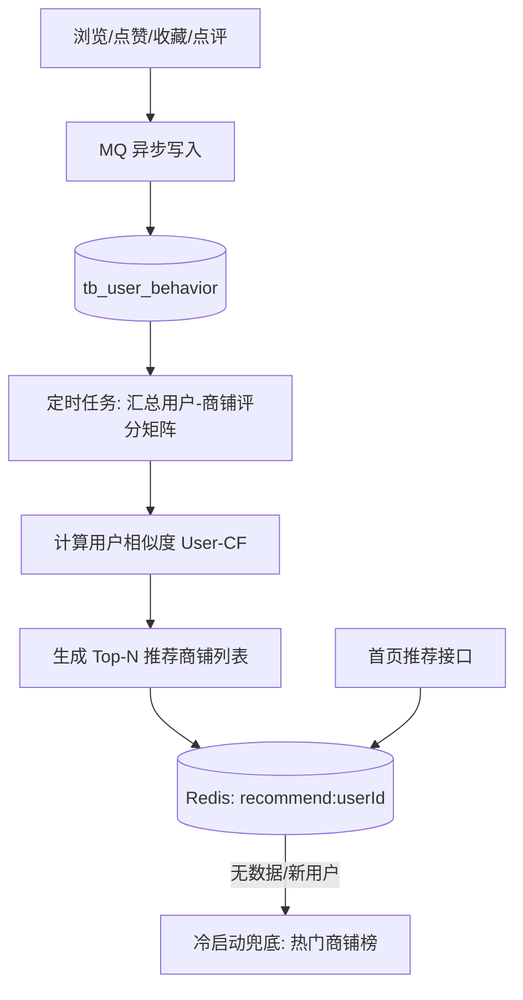
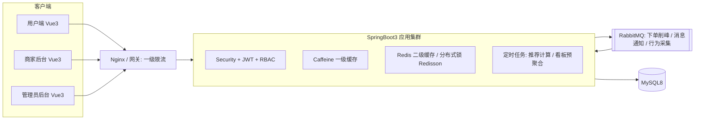

# 本地生活探店平台 · 阶段0 需求与设计文档

> 对应《开发步骤.md》阶段 0：敲定需求、ER 图、接口清单，不直接写代码。
> 项目：本地生活探店平台（升级版黑马点评｜方案1）
> 技术栈：SpringBoot3 + MySQL8 + Redis + Redisson + RabbitMQ + SpringSecurity + JWT + MyBatis-Plus ｜ Vue3 + Vite + Element Plus

---

## 目录

1. [项目定位与业务角色](#1-项目定位与业务角色)
2. [角色权限矩阵](#2-角色权限矩阵)
3. [功能模块清单](#3-功能模块清单)
4. [数据库设计（建表 SQL）](#4-数据库设计建表-sql)
5. [ER 图](#5-er-图)
6. [核心业务流程图](#6-核心业务流程图)
7. [系统架构图](#7-系统架构图)
8. [接口总清单](#8-接口总清单)
9. [接口通用约定](#9-接口通用约定)
10. [待你拍板的设计决策](#10-待你拍板的设计决策)

---

## 1. 项目定位与业务角色

面向本地生活场景的探店点评 + 优惠券秒杀平台，保留黑马点评高并发内核（缓存、分布式锁、MQ），新增**商家后台、RBAC、站内消息通知、简易协同过滤推荐**作为差异化。

| 角色 | 标识 | 核心业务 |
|------|------|----------|
| 普通用户 | `user` | 注册登录、查看商铺、发点评、点赞收藏、抢优惠券、个性化推荐流、接收站内消息 |
| 商家 | `merchant` | 入驻申请、管理商铺、发布/管理优惠券、核销优惠券、查看店铺数据看板 |
| 平台管理员 | `admin` | 审核入驻、审核点评、商铺上下架、账号管理、角色分配 |

**三个必须被表结构支撑的核心场景**：

1. 优惠券秒杀（高并发、防超卖、异步下单、订单幂等）
2. 站内消息推送（点赞、到期、审核结果，可靠投递 + 幂等消费）
3. 用户行为采集（浏览/点赞/收藏 → 协同过滤推荐）

---

## 2. 角色权限矩阵

| 功能 | user | merchant | admin |
|------|:----:|:--------:|:-----:|
| 浏览商铺/推荐流 | ✅ | ✅ | ✅ |
| 发布点评、点赞、收藏 | ✅ | ✅ | ✅ |
| 秒杀优惠券 | ✅ | ✅ | ✅ |
| 提交商家入驻申请 | ✅（申请通过后获得 merchant 角色） | — | — |
| 商铺 CRUD / 上下架 | ❌ | ✅（仅本名下） | 强制下架 |
| 优惠券发布与管理 | ❌ | ✅（仅本名下） | ❌ |
| 优惠券核销 | ❌ | ✅（仅本店券） | ❌ |
| 数据看板 | ❌ | ✅（仅本店） | 全站（可选） |
| 入驻审核 | ❌ | ❌ | ✅ |
| 点评审核 | ❌ | ❌ | ✅ |
| 账号管理 / 角色分配 | ❌ | ❌ | ✅ |

> 权限落地方式：`sys_role` + `sys_user_role` 多对多 RBAC，接口层用 `@PreAuthorize` 控制角色，Service 层做**数据归属校验**（merchant 只能操作自己名下数据）。

---

## 3. 功能模块清单

| 阶段 | 模块 | 关键技术点 |
|------|------|-----------|
| 基础 | 用户模块 | 注册/登录、JWT、BCrypt |
| 基础 | 商家模块 | 入驻申请、管理员审核、状态流转 |
| 基础 | 商铺模块 | 商铺 CRUD、审核、上下架 |
| 基础 | 优惠券模块 | 普通券/秒杀券、发布管理 |
| 基础 | 点评模块 | 发布、分页、审核 |
| 基础 | 点赞/收藏 | 复合主键防重 |
| 高并发 | 商铺多级缓存 | Caffeine 一级 + Redis 二级、预热、三大缓存问题 |
| 高并发 | 优惠券秒杀 | Redisson 锁、Lua 扣库存、两级限流、MQ 削峰、幂等 |
| 差异化 | 站内消息通知 | RabbitMQ、持久化、重试、死信队列、已读未读 |
| 差异化 | 行为采集 + 推荐 | MQ 异步落库、定时协同过滤、Redis 推荐列表 |
| 差异化 | 商家数据看板 | 定时预聚合统计表、折线图数据 |
| 支撑 | RBAC/账号管理 | 角色表、权限注解、路由守卫 |

---

## 4. 数据库设计（建表 SQL）

**设计约定**：

- MySQL 8、InnoDB、utf8mb4；金额用 `DECIMAL`；主键雪花/自增 `BIGINT`
- 物理外键一律不建（高并发写入场景便于扩展），关联关系通过索引 + 应用层保证，关系在 ER 图中标注
- 所有表/字段带中文注释

```sql
-- ============================================================
-- 0. 用户表
-- ============================================================
CREATE TABLE tb_user (
    id          BIGINT UNSIGNED NOT NULL AUTO_INCREMENT COMMENT '用户ID',
    phone       CHAR(11)        NOT NULL COMMENT '手机号（登录账号）',
    password    VARCHAR(100)    NOT NULL COMMENT 'BCrypt 加密密码',
    nickname    VARCHAR(64)     NOT NULL DEFAULT '' COMMENT '昵称',
    avatar      VARCHAR(255)             DEFAULT '' COMMENT '头像URL',
    gender      TINYINT         NOT NULL DEFAULT 2 COMMENT '性别 0男 1女 2未知',
    status      TINYINT         NOT NULL DEFAULT 1 COMMENT '状态 1正常 0冻结',
    create_time DATETIME        NOT NULL DEFAULT CURRENT_TIMESTAMP COMMENT '创建时间',
    update_time DATETIME        NOT NULL DEFAULT CURRENT_TIMESTAMP ON UPDATE CURRENT_TIMESTAMP COMMENT '更新时间',
    PRIMARY KEY (id),
    UNIQUE KEY uk_phone (phone)
) ENGINE = InnoDB DEFAULT CHARSET = utf8mb4 COMMENT ='用户表';

-- ============================================================
-- 1. RBAC：角色表 / 用户角色关联表
-- ============================================================
CREATE TABLE sys_role (
    id          BIGINT UNSIGNED NOT NULL AUTO_INCREMENT COMMENT '角色ID',
    role_code   VARCHAR(32)     NOT NULL COMMENT '角色编码 user/merchant/admin',
    role_name   VARCHAR(32)     NOT NULL COMMENT '角色名称',
    description VARCHAR(128)             DEFAULT '' COMMENT '描述',
    status      TINYINT         NOT NULL DEFAULT 1 COMMENT '1启用 0停用',
    create_time DATETIME        NOT NULL DEFAULT CURRENT_TIMESTAMP COMMENT '创建时间',
    update_time DATETIME        NOT NULL DEFAULT CURRENT_TIMESTAMP ON UPDATE CURRENT_TIMESTAMP COMMENT '更新时间',
    PRIMARY KEY (id),
    UNIQUE KEY uk_role_code (role_code)
) ENGINE = InnoDB DEFAULT CHARSET = utf8mb4 COMMENT ='角色表';

CREATE TABLE sys_user_role (
    id      BIGINT UNSIGNED NOT NULL AUTO_INCREMENT COMMENT '主键',
    user_id BIGINT UNSIGNED NOT NULL COMMENT '用户ID',
    role_id BIGINT UNSIGNED NOT NULL COMMENT '角色ID',
    PRIMARY KEY (id),
    UNIQUE KEY uk_user_role (user_id, role_id),
    KEY idx_role_id (role_id)
) ENGINE = InnoDB DEFAULT CHARSET = utf8mb4 COMMENT ='用户角色关联表';

-- ============================================================
-- 2. 商家信息表（差异化：与普通用户资料分离）
-- ============================================================
CREATE TABLE tb_merchant (
    id             BIGINT UNSIGNED NOT NULL AUTO_INCREMENT COMMENT '商家ID',
    user_id        BIGINT UNSIGNED NOT NULL COMMENT '关联用户ID',
    merchant_name  VARCHAR(128)    NOT NULL COMMENT '商家/公司名称',
    license_no     VARCHAR(64)     NOT NULL COMMENT '营业执照编号',
    license_img    VARCHAR(255)             DEFAULT '' COMMENT '营业执照照片',
    contact_name   VARCHAR(32)     NOT NULL COMMENT '联系人',
    contact_phone  CHAR(11)        NOT NULL COMMENT '联系电话',
    status         TINYINT         NOT NULL DEFAULT 0 COMMENT '状态 0待审核 1已通过 2已驳回',
    audit_admin_id BIGINT UNSIGNED          DEFAULT NULL COMMENT '审核管理员ID',
    audit_time     DATETIME                 DEFAULT NULL COMMENT '审核时间',
    audit_remark   VARCHAR(255)             DEFAULT '' COMMENT '审核备注/驳回原因',
    create_time    DATETIME        NOT NULL DEFAULT CURRENT_TIMESTAMP COMMENT '创建时间',
    update_time    DATETIME        NOT NULL DEFAULT CURRENT_TIMESTAMP ON UPDATE CURRENT_TIMESTAMP COMMENT '更新时间',
    PRIMARY KEY (id),
    UNIQUE KEY uk_user_id (user_id),
    KEY idx_status (status)
) ENGINE = InnoDB DEFAULT CHARSET = utf8mb4 COMMENT ='商家信息表';

-- ============================================================
-- 3. 商铺表
-- ============================================================
CREATE TABLE tb_shop (
    id          BIGINT UNSIGNED NOT NULL AUTO_INCREMENT COMMENT '商铺ID',
    merchant_id BIGINT UNSIGNED NOT NULL COMMENT '所属商家ID',
    name        VARCHAR(128)    NOT NULL COMMENT '商铺名称',
    type_id     INT             NOT NULL COMMENT '商铺类型ID',
    type_name   VARCHAR(32)     NOT NULL DEFAULT '' COMMENT '类型名称（冗余）',
    province    VARCHAR(32)              DEFAULT '' COMMENT '省',
    city        VARCHAR(32)              DEFAULT '' COMMENT '市',
    address     VARCHAR(255)    NOT NULL COMMENT '详细地址',
    longitude   DECIMAL(10, 7)           DEFAULT NULL COMMENT '经度',
    latitude    DECIMAL(10, 7)           DEFAULT NULL COMMENT '纬度',
    cover_img   VARCHAR(255)             DEFAULT '' COMMENT '封面图',
    images      VARCHAR(1000)            DEFAULT '' COMMENT '门店图片，逗号分隔',
    description TEXT                     DEFAULT NULL COMMENT '简介',
    avg_price   DECIMAL(10, 2)           DEFAULT 0 COMMENT '人均消费',
    status      TINYINT         NOT NULL DEFAULT 0 COMMENT '0待审核 1营业 2已下架',
    create_time DATETIME        NOT NULL DEFAULT CURRENT_TIMESTAMP COMMENT '创建时间',
    update_time DATETIME        NOT NULL DEFAULT CURRENT_TIMESTAMP ON UPDATE CURRENT_TIMESTAMP COMMENT '更新时间',
    PRIMARY KEY (id),
    KEY idx_merchant (merchant_id),
    KEY idx_status (status)
) ENGINE = InnoDB DEFAULT CHARSET = utf8mb4 COMMENT ='商铺表';

-- ============================================================
-- 4. 优惠券表（普通券 + 秒杀券）
-- ============================================================
CREATE TABLE tb_voucher (
    id           BIGINT UNSIGNED NOT NULL AUTO_INCREMENT COMMENT '优惠券ID',
    shop_id      BIGINT UNSIGNED NOT NULL COMMENT '所属商铺ID',
    title        VARCHAR(128)    NOT NULL COMMENT '券标题',
    sub_title    VARCHAR(255)             DEFAULT '' COMMENT '副标题',
    rules        VARCHAR(512)             DEFAULT '' COMMENT '使用规则',
    pay_value    DECIMAL(10, 2)  NOT NULL COMMENT '支付金额',
    actual_value DECIMAL(10, 2)  NOT NULL COMMENT '抵扣金额',
    type         TINYINT         NOT NULL DEFAULT 0 COMMENT '类型 0普通券 1秒杀券',
    status       TINYINT         NOT NULL DEFAULT 1 COMMENT '1上架 0下架',
    begin_time   DATETIME                 DEFAULT NULL COMMENT '生效时间',
    end_time     DATETIME                 DEFAULT NULL COMMENT '失效时间',
    create_time  DATETIME        NOT NULL DEFAULT CURRENT_TIMESTAMP COMMENT '创建时间',
    update_time  DATETIME        NOT NULL DEFAULT CURRENT_TIMESTAMP ON UPDATE CURRENT_TIMESTAMP COMMENT '更新时间',
    PRIMARY KEY (id),
    KEY idx_shop (shop_id),
    KEY idx_end_time (end_time)
) ENGINE = InnoDB DEFAULT CHARSET = utf8mb4 COMMENT ='优惠券表';

-- 秒杀券专属库存与时间（与普通券区分，热点独立）
CREATE TABLE tb_seckill_voucher (
    voucher_id    BIGINT UNSIGNED NOT NULL COMMENT '关联优惠券ID',
    initial_stock INT             NOT NULL COMMENT '初始库存',
    stock         INT             NOT NULL COMMENT '剩余库存（DB 兜底值）',
    begin_time    DATETIME        NOT NULL COMMENT '秒杀开始时间',
    end_time      DATETIME        NOT NULL COMMENT '秒杀结束时间',
    create_time   DATETIME        NOT NULL DEFAULT CURRENT_TIMESTAMP COMMENT '创建时间',
    update_time   DATETIME        NOT NULL DEFAULT CURRENT_TIMESTAMP ON UPDATE CURRENT_TIMESTAMP COMMENT '更新时间',
    PRIMARY KEY (voucher_id),
    KEY idx_time (begin_time, end_time)
) ENGINE = InnoDB DEFAULT CHARSET = utf8mb4 COMMENT ='秒杀券表';

-- ============================================================
-- 5. 优惠券订单表
-- ============================================================
CREATE TABLE tb_voucher_order (
    id           BIGINT UNSIGNED NOT NULL COMMENT '订单ID（雪花算法）',
    user_id      BIGINT UNSIGNED NOT NULL COMMENT '下单用户ID',
    voucher_id   BIGINT UNSIGNED NOT NULL COMMENT '优惠券ID',
    shop_id      BIGINT UNSIGNED NOT NULL COMMENT '商铺ID（冗余）',
    order_type   TINYINT         NOT NULL DEFAULT 1 COMMENT '订单类型 0普通 1秒杀',
    status       TINYINT         NOT NULL DEFAULT 1 COMMENT '1未支付 2已支付待核销 3已核销 4已退款 5已关闭',
    pay_type     TINYINT                  DEFAULT NULL COMMENT '支付方式',
    create_time  DATETIME        NOT NULL DEFAULT CURRENT_TIMESTAMP COMMENT '下单时间',
    pay_time     DATETIME                 DEFAULT NULL COMMENT '支付时间',
    use_time     DATETIME                 DEFAULT NULL COMMENT '核销时间',
    refund_time  DATETIME                 DEFAULT NULL COMMENT '退款时间',
    close_time   DATETIME                 DEFAULT NULL COMMENT '关闭时间',
    PRIMARY KEY (id),
    UNIQUE KEY uk_user_voucher (user_id, voucher_id) COMMENT '每人每券限购1份 + 订单幂等兜底',
    KEY idx_user (user_id),
    KEY idx_voucher (voucher_id),
    KEY idx_shop_status (shop_id, status),
    KEY idx_create_time (create_time)
) ENGINE = InnoDB DEFAULT CHARSET = utf8mb4 COMMENT ='优惠券订单表';

-- ============================================================
-- 6. 点评表
-- ============================================================
CREATE TABLE tb_review (
    id             BIGINT UNSIGNED NOT NULL AUTO_INCREMENT COMMENT '点评ID',
    shop_id        BIGINT UNSIGNED NOT NULL COMMENT '商铺ID',
    user_id        BIGINT UNSIGNED NOT NULL COMMENT '发布用户ID',
    title          VARCHAR(128)    NOT NULL COMMENT '标题',
    content        TEXT            NOT NULL COMMENT '正文',
    images         VARCHAR(1000)            DEFAULT '' COMMENT '图片，逗号分隔',
    score          TINYINT         NOT NULL DEFAULT 5 COMMENT '评分 1~5',
    status         TINYINT         NOT NULL DEFAULT 0 COMMENT '0待审核 1已通过 2已驳回',
    audit_admin_id BIGINT UNSIGNED           DEFAULT NULL COMMENT '审核管理员ID',
    audit_time     DATETIME                 DEFAULT NULL COMMENT '审核时间',
    audit_remark   VARCHAR(255)             DEFAULT '' COMMENT '审核备注',
    create_time    DATETIME        NOT NULL DEFAULT CURRENT_TIMESTAMP COMMENT '创建时间',
    update_time    DATETIME        NOT NULL DEFAULT CURRENT_TIMESTAMP ON UPDATE CURRENT_TIMESTAMP COMMENT '更新时间',
    PRIMARY KEY (id),
    KEY idx_shop_time (shop_id, create_time),
    KEY idx_user (user_id),
    KEY idx_status (status)
) ENGINE = InnoDB DEFAULT CHARSET = utf8mb4 COMMENT ='点评表';

-- ============================================================
-- 7. 点赞表 / 收藏表（复合主键天然防重）
-- ============================================================
CREATE TABLE tb_review_like (
    user_id     BIGINT UNSIGNED NOT NULL COMMENT '用户ID',
    review_id   BIGINT UNSIGNED NOT NULL COMMENT '点评ID',
    create_time DATETIME        NOT NULL DEFAULT CURRENT_TIMESTAMP COMMENT '点赞时间',
    PRIMARY KEY (user_id, review_id),
    KEY idx_review (review_id)
) ENGINE = InnoDB DEFAULT CHARSET = utf8mb4 COMMENT ='点评点赞表';

CREATE TABLE tb_favorite (
    user_id     BIGINT UNSIGNED NOT NULL COMMENT '用户ID',
    shop_id     BIGINT UNSIGNED NOT NULL COMMENT '商铺ID',
    create_time DATETIME        NOT NULL DEFAULT CURRENT_TIMESTAMP COMMENT '收藏时间',
    PRIMARY KEY (user_id, shop_id),
    KEY idx_user_time (user_id, create_time)
) ENGINE = InnoDB DEFAULT CHARSET = utf8mb4 COMMENT ='商铺收藏表';

-- ============================================================
-- 8. 站内消息表（差异化）
-- ============================================================
CREATE TABLE tb_message (
    id               BIGINT UNSIGNED NOT NULL AUTO_INCREMENT COMMENT '消息ID',
    receiver_user_id BIGINT UNSIGNED NOT NULL COMMENT '接收人用户ID',
    type             TINYINT         NOT NULL COMMENT '类型 1点赞提醒 2优惠券到期 3入驻审核结果 4点评审核结果',
    title            VARCHAR(128)    NOT NULL COMMENT '标题',
    content          VARCHAR(512)    NOT NULL COMMENT '内容',
    biz_type         VARCHAR(32)              DEFAULT '' COMMENT '业务类型',
    biz_id           BIGINT UNSIGNED           DEFAULT NULL COMMENT '关联业务ID',
    is_read          TINYINT         NOT NULL DEFAULT 0 COMMENT '0未读 1已读',
    create_time      DATETIME        NOT NULL DEFAULT CURRENT_TIMESTAMP COMMENT '创建时间',
    read_time        DATETIME                 DEFAULT NULL COMMENT '阅读时间',
    PRIMARY KEY (id),
    KEY idx_receiver_read (receiver_user_id, is_read, create_time)
) ENGINE = InnoDB DEFAULT CHARSET = utf8mb4 COMMENT ='站内消息表';

-- ============================================================
-- 9. 用户行为日志表（差异化：只追加，供推荐计算）
-- ============================================================
CREATE TABLE tb_user_behavior (
    id            BIGINT UNSIGNED NOT NULL AUTO_INCREMENT COMMENT '日志ID',
    user_id       BIGINT UNSIGNED NOT NULL COMMENT '用户ID',
    shop_id       BIGINT UNSIGNED NOT NULL COMMENT '商铺ID',
    behavior_type TINYINT         NOT NULL COMMENT '1浏览 2点赞 3收藏 4点评',
    weight        INT             NOT NULL DEFAULT 1 COMMENT '行为权重 浏览1/点评3/点赞4/收藏5',
    create_time   DATETIME        NOT NULL DEFAULT CURRENT_TIMESTAMP COMMENT '行为时间',
    PRIMARY KEY (id),
    KEY idx_user_time (user_id, create_time),
    KEY idx_shop (shop_id),
    KEY idx_time (create_time)
) ENGINE = InnoDB DEFAULT CHARSET = utf8mb4 COMMENT ='用户行为日志表';

-- ============================================================
-- 10. 商铺日统计表（看板预聚合）
-- ============================================================
CREATE TABLE tb_shop_daily_stat (
    id             BIGINT UNSIGNED NOT NULL AUTO_INCREMENT COMMENT '主键',
    shop_id        BIGINT UNSIGNED NOT NULL COMMENT '商铺ID',
    stat_date      DATE            NOT NULL COMMENT '统计日期',
    visit_count    INT             NOT NULL DEFAULT 0 COMMENT '当日访问量',
    writeoff_count INT             NOT NULL DEFAULT 0 COMMENT '当日核销数量',
    review_count   INT             NOT NULL DEFAULT 0 COMMENT '当日点评数',
    avg_score      DECIMAL(3, 2)            DEFAULT NULL COMMENT '当日平均评分',
    create_time    DATETIME        NOT NULL DEFAULT CURRENT_TIMESTAMP COMMENT '创建时间',
    update_time    DATETIME        NOT NULL DEFAULT CURRENT_TIMESTAMP ON UPDATE CURRENT_TIMESTAMP COMMENT '更新时间',
    PRIMARY KEY (id),
    UNIQUE KEY uk_shop_date (shop_id, stat_date)
) ENGINE = InnoDB DEFAULT CHARSET = utf8mb4 COMMENT ='商铺日统计表';

-- ============================================================
-- 初始化角色数据
-- ============================================================
INSERT INTO sys_role (role_code, role_name, description)
VALUES ('user', '普通用户', '浏览/点评/收藏/秒杀/推荐'),
       ('merchant', '商家', '商铺管理/优惠券管理/核销/数据看板'),
       ('admin', '平台管理员', '审核/账号/角色管理');
```

---

## 5. ER 图



---

## 6. 核心业务流程图

### 6.1 优惠券秒杀流程



### 6.2 站内消息推送流程



### 6.3 协同过滤推荐流计算流程



---

## 7. 系统架构图



---

## 8. 接口总清单

### 8.1 认证与用户

| # | 方法 | 路径 | 权限 | 说明 |
|---|------|------|------|------|
| 1 | POST | /api/auth/register | 公开 | 手机号注册，默认授予 user 角色 |
| 2 | POST | /api/auth/login | 公开 | 登录，返回 JWT |
| 3 | GET | /api/users/me | 登录 | 当前用户信息与角色 |
| 4 | PUT | /api/users/me | 登录 | 修改昵称/头像等 |

### 8.2 商家入驻与商铺

| # | 方法 | 路径 | 权限 | 说明 |
|---|------|------|------|------|
| 5 | POST | /api/merchant/apply | 登录 | 提交入驻申请 |
| 6 | GET | /api/merchant/me | merchant | 查看自己的入驻资料/状态 |
| 7 | GET | /api/shops | 公开 | 商铺分页列表（类型/关键字） |
| 8 | GET | /api/shops/{id} | 公开 | 商铺详情（走多级缓存，异步记行为） |
| 9 | GET | /api/merchant/shops | merchant | 名下商铺列表 |
| 10 | POST | /api/merchant/shops | merchant | 新建商铺（待审核） |
| 11 | PUT | /api/merchant/shops/{id} | merchant | 修改商铺（归属校验） |
| 12 | PUT | /api/merchant/shops/{id}/status | merchant | 上架/下架（归属校验） |
| 13 | GET | /api/admin/merchants | admin | 入驻申请分页列表 |
| 14 | PUT | /api/admin/merchants/{id}/audit | admin | 审核入驻，通过则授予 merchant 角色 |
| 15 | PUT | /api/admin/shops/{id}/audit | admin | 商铺审核/强制下架 |

### 8.3 优惠券与秒杀

| # | 方法 | 路径 | 权限 | 说明 |
|---|------|------|------|------|
| 16 | GET | /api/shops/{id}/vouchers | 公开 | 店铺优惠券列表 |
| 17 | POST | /api/merchant/vouchers | merchant | 发布普通券/秒杀券 |
| 18 | PUT | /api/merchant/vouchers/{id} | merchant | 编辑（归属校验） |
| 19 | PUT | /api/merchant/vouchers/{id}/status | merchant | 上/下架 |
| 20 | POST | /api/vouchers/{id}/seckill | 登录 | 秒杀（限流+Lua 扣库存+MQ 下单） |
| 21 | GET | /api/voucher-orders/me | 登录 | 我的订单分页 |
| 22 | PUT | /api/voucher-orders/{id}/pay | 登录 | 模拟支付 |
| 23 | PUT | /api/merchant/voucher-orders/{id}/writeoff | merchant | 核销优惠券（归属校验） |

### 8.4 点评 / 点赞 / 收藏

| # | 方法 | 路径 | 权限 | 说明 |
|---|------|------|------|------|
| 24 | POST | /api/shops/{id}/reviews | 登录 | 发布点评（待审核） |
| 25 | GET | /api/shops/{id}/reviews | 公开 | 商铺点评分页 |
| 26 | GET | /api/reviews/me | 登录 | 我的点评 |
| 27 | PUT | /api/reviews/{id}/like | 登录 | 点赞（防重，触发消息） |
| 28 | DELETE | /api/reviews/{id}/like | 登录 | 取消点赞 |
| 29 | PUT | /api/shops/{id}/favorite | 登录 | 收藏 |
| 30 | DELETE | /api/shops/{id}/favorite | 登录 | 取消收藏 |
| 31 | GET | /api/favorites | 登录 | 我的收藏分页 |
| 32 | PUT | /api/admin/reviews/{id}/audit | admin | 点评审核，触发结果消息 |

### 8.5 站内消息

| # | 方法 | 路径 | 权限 | 说明 |
|---|------|------|------|------|
| 33 | GET | /api/messages | 登录 | 消息分页（可按已读过滤） |
| 34 | GET | /api/messages/unread-count | 登录 | 未读数（小红点） |
| 35 | PUT | /api/messages/{id}/read | 登录 | 单条已读 |
| 36 | PUT | /api/messages/read-all | 登录 | 全部已读 |

### 8.6 推荐流

| # | 方法 | 路径 | 权限 | 说明 |
|---|------|------|------|------|
| 37 | GET | /api/recommendations/feed | 登录 | 个性化推荐商铺流（Redis，冷启动兜底） |

### 8.7 商家数据看板

| # | 方法 | 路径 | 权限 | 说明 |
|---|------|------|------|------|
| 38 | GET | /api/merchant/dashboard/overview | merchant | 概览（访问/核销/评分汇总） |
| 39 | GET | /api/merchant/dashboard/visit-trend | merchant | 访问量折线（日粒度+区间） |
| 40 | GET | /api/merchant/dashboard/writeoff-trend | merchant | 核销趋势折线 |
| 41 | GET | /api/merchant/dashboard/score | merchant | 评分分布 |

### 8.8 管理员账号管理

| # | 方法 | 路径 | 权限 | 说明 |
|---|------|------|------|------|
| 42 | GET | /api/admin/users | admin | 用户分页列表 |
| 43 | PUT | /api/admin/users/{id}/status | admin | 冻结/解冻账号 |
| 44 | PUT | /api/admin/users/{id}/roles | admin | 分配角色 |

---

## 9. 接口通用约定

- 统一前缀 `/api`；请求/响应均为 JSON；JWT 放在 `Authorization: Bearer <token>`
- 统一响应体：

```json
{ "code": 200, "message": "success", "data": {} }
```

- 分页请求参数：`pageNum`（默认 1）、`pageSize`（默认 10）；分页返回：`total`、`records`
- 常用错误码：200 成功 / 400 参数错误 / 401 未认证 / 403 无权限 / 404 资源不存在 / 429 触发限流 / 500 系统异常
- 秒杀接口额外返回约定：库存不足、不在活动时间、重复下单使用独立业务码（如 501/502/503），便于前端区分提示

---

## 10. 待你拍板的设计决策

> 以下必须由你决定（面试要讲），Agent 只按你的决定编码：

1. **缓存更新策略**：推荐"更新 DB + 删除缓存 + 短过期"，商铺变更通过 MQ 广播失效各节点 Caffeine；是否采用 TTL 兜底由你定。
2. **秒杀库存位置**：Redis 为主库存（Lua 扣减），DB `tb_seckill_voucher.stock` 只作兜底；是否允许 Redis/DB 异步一致需要你确认。
3. **限购规则**：当前设计每人每券 1 张（订单表唯一键兜底幂等），如需支持普通券多买需调整。
4. **相似度算法**：采用 User-CF + 余弦相似度（行为加权），每日凌晨定时计算；冷启动返回热门榜。
5. **消息可靠性组合**：生产者 confirm + 消息/队列持久化 + 消费者手动 ack + 消费端幂等 + 死信队列。
6. **压测目标值**：JMeter 脚本由 Agent 生成，单机 QPS / RT 目标由你在压测后填入下表：

| 指标 | 优化前 | 优化后 |
|------|--------|--------|
| 商铺详情 QPS | 待测 | 待测 |
| 秒杀接口 QPS | 待测 | 待测 |
| 秒杀平均 RT | 待测 | 待测 |
| 超卖订单数 | — | 必须为 0 |
